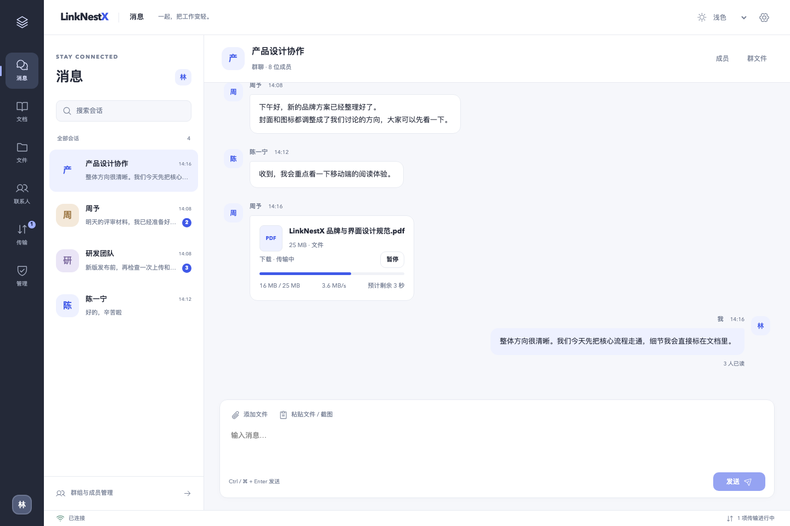
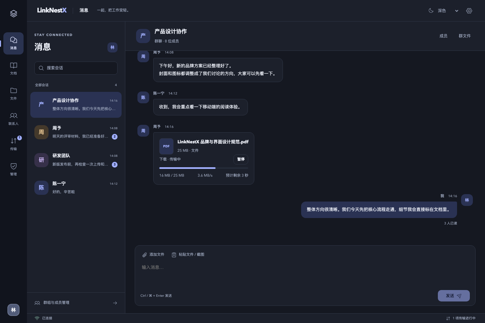
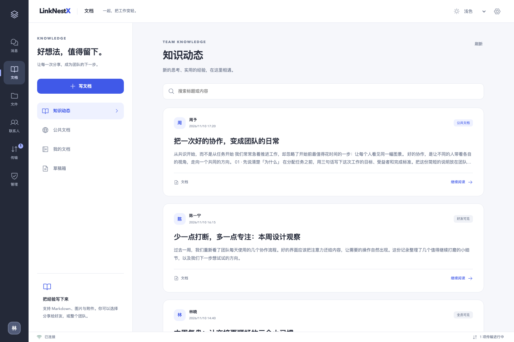
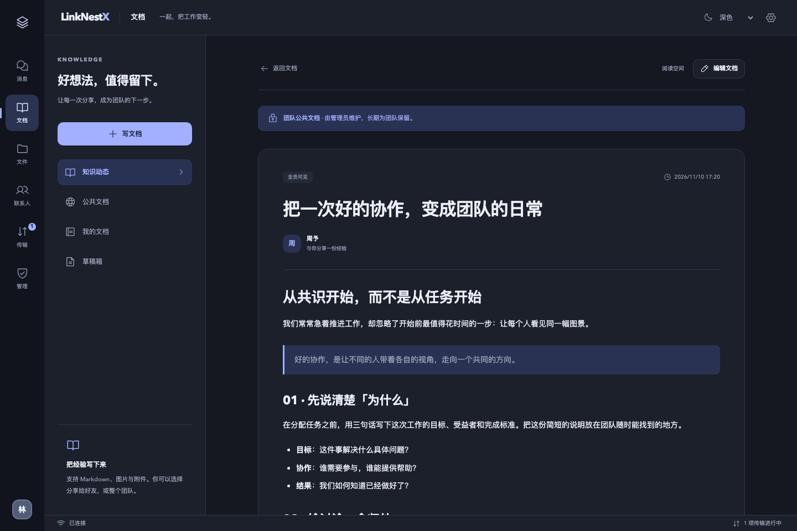
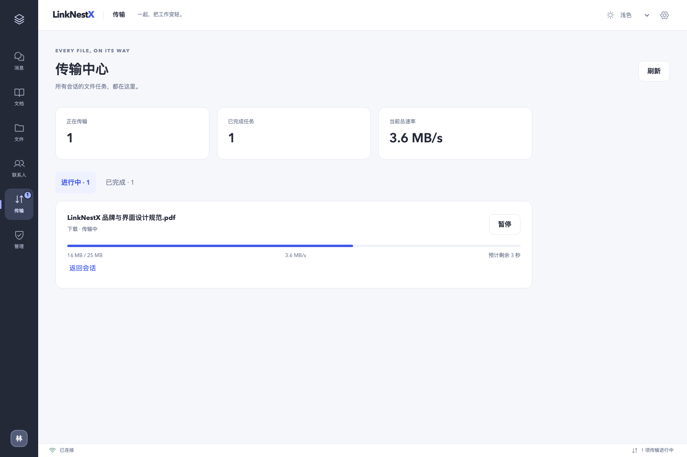
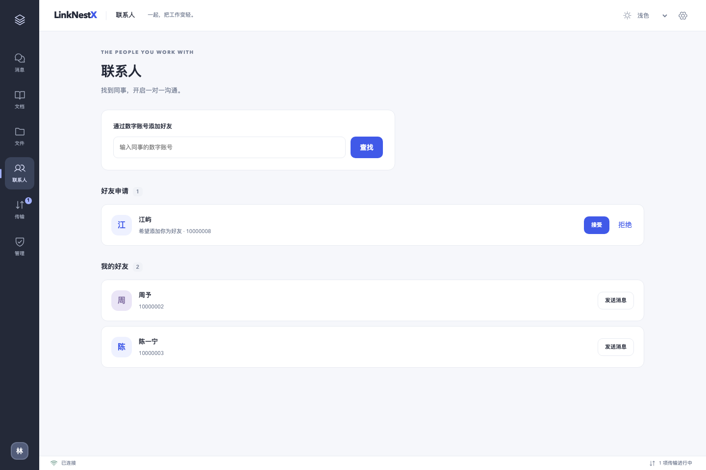
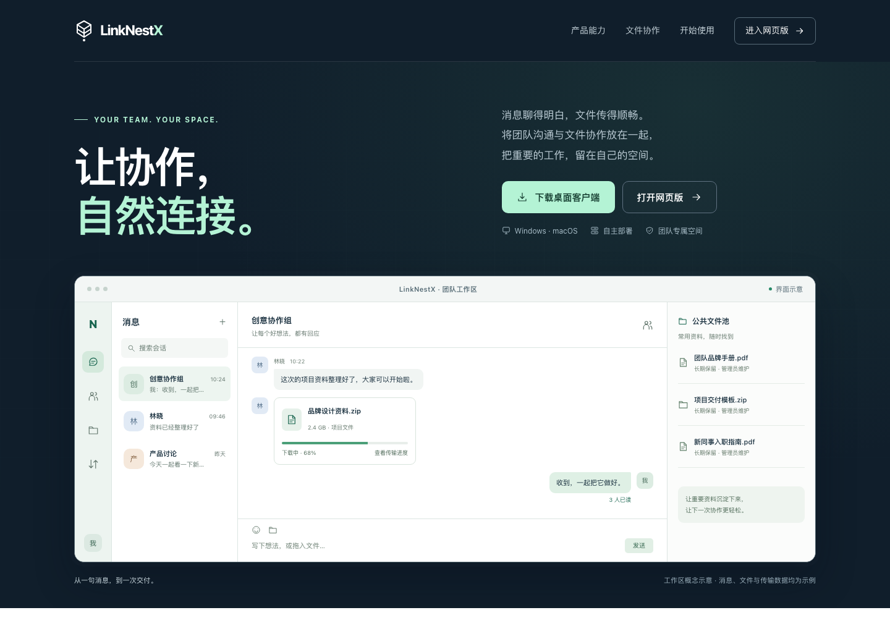
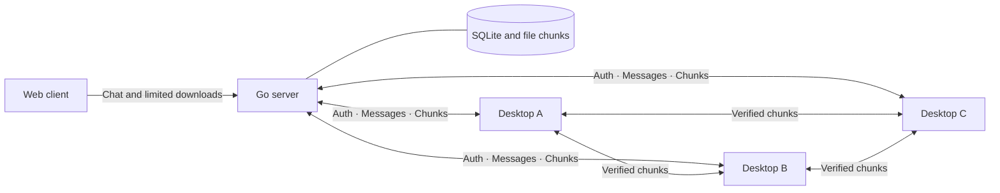

<div align="center">

# LinkNestX

### Bring conversations and files together.

A self-hosted workspace for team chat and file collaboration. Conversations, Markdown notes, large transfers, and team knowledge in one place.

[简体中文](README.md) · **English**


[](LICENSE)

[Features](#features) · [Preview](#preview) · [Quick start](#quick-start) · [Deployment](docs/deployment.md) · [Roadmap](#roadmap)

</div>

---

LinkNestX is for teams that want to manage their own collaboration data. Your server stores messages and file records, the desktop app handles large files and background work, and the browser provides a lightweight chat entry point. Downloads can combine data from the server and other authorized clients. Verified chunks become available to peers before the entire file finishes downloading.

> **Status: 0.3 development preview.** Includes a redesigned workspace, light/dark/system themes and a document library. Windows 7 SP1 uses separate x86/x64 packages with a bundled runtime; modern Windows and macOS use the standard client. See [verification scope](#verification) for build and device acceptance limits.

<a id="preview"></a>
## Preview

<p align="center">
  
</p>

<p align="center"><sub>Actual UI components with sample data, showing chat, inline transfer progress, and read receipts.</sub></p>

<details>
<summary>View dark mode and the document library</summary>







Documents support Markdown, individual visibility settings and administrator curation.

</details>

<details>
<summary>View the transfer center and contacts</summary>





These screenshots use sample data. They do not represent real users, measured transfer speeds, or a production deployment.

</details>

<details>
<summary>View the product homepage design</summary>



</details>

<a id="features"></a>
## Why LinkNestX

| Capability | What it brings to your team |
| --- | --- |
| **Chat with read receipts** | Group and friend-to-friend conversations, numeric accounts, and avatars. See whether a direct message was read, or open the reader list in a group. |
| **Files inside the conversation** | Drop or paste files and screenshots in the desktop composer. File cards show progress, current speed, and estimated time remaining. |
| **Parallel downloads from multiple sources** | Receive verified chunks from the server and authorized clients, with partial-file serving, resumable transfers, and server fallback. |
| **Large transfers that keep going** | Desktop files up to 20 GB. Keep tasks running in the system tray, and manage progress, elapsed time, and average speed in the transfer center. |
| **Documents and team knowledge** | Write Markdown tutorials and notes with drafts, private/friends/team visibility and durable attachments. Administrators maintain curated documents. |
| **A unified workspace and themes** | Redesigned messages, contacts, documents, files and transfers with light, dark and system appearance. |
| **A shared team file library** | Administrators can promote sent files to the shared pool, where all signed-in employees can find and download them without automatic expiry. |
| **Data under your control** | A Go server stores chat, file, and audit records. Administrators manage employee accounts, membership permissions, and device sessions. |
| **A lightweight web client** | The same service provides browser login, chat, contacts, and downloads without requiring an installation. |
| **Built-in updates** | Prepare signed incremental updates in the background, defer installation during transfers, and recover with verified full downloads or rollback. |

### Desktop and web

| Feature | Desktop (Windows / macOS) | Web |
| --- | --- | --- |
| Group chat, direct messages, read receipts | ✓ | ✓ |
| Numeric accounts, contacts, profile viewing | ✓ | ✓ |
| Group files and shared-pool downloads | Up to 20 GB per file | Up to 1 GB per file, one download at a time |
| Upload, drag and drop, file paste | ✓ | — |
| Multi-source transfers, pause and resume | ✓ | — |
| Transfers after closing the window | While the app remains in the system tray | — |
| Transfer statistics | ✓ | — |
| Incremental in-app updates | Standard client; Win7 uses full-package updates | — |
| Markdown documents, drafts and visibility | ✓ | ✓ (text editing) |
| Document attachment upload and P2P | ✓ | — |
| Light, dark and system themes | ✓ | ✓ |
| Administrative write operations | ✓ | — |

Web restrictions are enforced by the server. The browser manages its own downloads; use the desktop app for full file collaboration. This table describes implemented capabilities, with platform acceptance status listed below.

<details>
<summary>Accounts, read receipts, and retention rules</summary>

- Administrators create accounts; there is no self-service registration. Employees receive unique numeric accounts, and direct messaging opens after a friend request is accepted.
- Messages are marked read only when actually visible in the foreground. Group counts include current members entitled to view the message, excluding its sender.
- Ordinary files expire **30 days** after upload completion and are deleted automatically. Shared-pool files **do not expire**; administrators manage and delete them.
- Documents and their attachments **do not expire automatically**. Curated documents are available only to signed-in employees; original authors cannot edit or delete curated content or attachments.
- Chat and audit records are retained for **two calendar years**, using UTC dates for cleanup boundaries.
- The shared pool is for signed-in employees, not anonymous sharing. Group files still require membership in the corresponding group.
- 20 GB / 1 GB mean 20,000,000,000 / 1,000,000,000 bytes respectively.
- Closing the desktop window leaves the app in the tray. Quitting from the tray ends the app. Signing out, disabling an account, or revoking a device affects subsequent authorization.

</details>

## How files move



If A has the beginning of a file, B the middle, and C the end, they can exchange verified portions while continuing to request other chunks from the server. The server handles identity, access permissions, file manifests, and peer coordination. Clients only serve authorized content. Available sources depend on online peers and network conditions; STUN/TURN can be configured for networks with NAT.

<a id="quick-start"></a>
## Quick start

### 1. Prepare your environment

After obtaining the source, install **Go 1.26+, Node.js 22+, and npm 10+**. The web client does not require Rust. Desktop development also needs **Rust 1.90+** and platform build tools; see the [development guide](docs/development.md). That guide records the exact toolchain versions used to verify the locked dependencies.

### 2. Start the local server and web client

Run these commands from the repository root in **Bash on Linux or macOS**:

```bash
npm --prefix client ci
npm --prefix client run build

export LINKNESTX_WEB_ASSETS_DIR="$PWD/client/dist"
export LINKNESTX_BOOTSTRAP_ADMIN_USERNAME="admin"
read -r -s -p "Initial admin password (at least 8 characters): " LINKNESTX_BOOTSTRAP_ADMIN_PASSWORD
printf '\n'
export LINKNESTX_BOOTSTRAP_ADMIN_PASSWORD

./scripts/dev-server.sh
```

Open **[http://127.0.0.1:8080/app/](http://127.0.0.1:8080/app/)** and sign in with the account you just configured. The homepage is at `/`, client downloads at `/downloads`, and the health endpoint at `/healthz`. The download page only lists installers actually published by the administrator.

The service listens on loopback by default and stores data in `server/data/`. After the first initialization, stop it and run the following before starting it again. This does not reset the existing account's password:

```bash
unset LINKNESTX_BOOTSTRAP_ADMIN_USERNAME LINKNESTX_BOOTSTRAP_ADMIN_PASSWORD
./scripts/dev-server.sh
```

This setup is for local evaluation. Before exposing it to a team, configure separate access-token and refresh-token keys, persistent storage, and the service address. Use HTTPS for public access. Configuration must be supplied through the process environment; `.env` files are not loaded automatically. See the [deployment guide](docs/deployment.md).

### 3. Start desktop development

Set `SERVER_ORIGIN` in [deployment.rs](client/src-tauri/src/deployment.rs) to your server address. Use `http://127.0.0.1:8080` for local development. The address is fixed at build time, so employees do not need to enter it.

```bash
make dev-client
# Without Make:
npm --prefix client run desktop:dev
```

Set the real deployment address and rebuild before distributing a client. Platform prerequisites, tests, signing, and packaging commands are in the [development guide](docs/development.md).

## Documentation

| Document | Contents |
| --- | --- |
| [Development guide](docs/development.md) | Environment, development, tests, packaging, and contribution workflow |
| [Deployment guide](docs/deployment.md) | Persistence, service configuration, HTTPS, STUN/TURN, and platform signing |
| [Windows compatibility](docs/windows-compatibility.md) | Standard and Win7 SP1 x86/x64 packages, installation and updates |
| [HTTP API](api/openapi.yaml) | Server API definitions |
| [Transfer contract](docs/transfer-contract.md) | File manifests, chunks, and transfer conventions |
| [Update format](docs/update-format.md) | Offline signing, content objects, and publication |
| [Desktop updates](docs/update-client.md) | Install locations, activity gates, health checks, and rollback |

Some detailed operational documents are currently in Chinese. This README provides equivalent Chinese and English introductions and setup instructions.

<a id="verification"></a>
## Release and verification scope

The server, frontend and native transfer core have automated regression suites. Document checks cover migration preservation, visibility, friendship revocation, curation locks, historical attachments and upload/download against a real server. UI screenshots use sample data. Consult the [Actions run for the corresponding commit](https://github.com/tianli-sir/LinkNestX/actions) for build status.

The following still require target-environment acceptance:

- **Windows 7 SP1 x86/x64 device acceptance**. Compatibility packages use Electron 22 and the shared native P2P core. This runtime is no longer maintained; compilation does not establish Win7 runtime compatibility. The standard client requires Windows 10/11.
- The local macOS build has an ad-hoc signature, **without Developer ID signing or notarization**. Interactive OS drag and drop, clipboard handling, and a complete installed-client upgrade still need validation.
- Real cross-NAT / TURN networks, a physical 20 GB transfer, and production deployment. The 20 GB manifest and 1 GB web-limit tests are not transfers of those sizes.
- GitHub Actions workflows are configured; their status must be read from actual remote runs.

**Version 0.1 has no updater: the first upgrade to 0.2 requires manual installation.** Later releases can use the built-in update flow. Incremental reuse depends on actual file changes; no fixed bandwidth saving is guaranteed.

<a id="roadmap"></a>
## Roadmap

- [x] Group chat, friend-to-friend messages, numeric accounts, and read receipts
- [x] Shared file pool, access control, retention, and audit records
- [x] Multi-source chunk transfers, resume, and transfer metrics
- [x] Restricted web client and signed incremental update implementation
- [x] Redesigned workspace and light/dark/system appearance
- [x] Markdown notes, attachments and administrator-curated knowledge
- [ ] Complete Windows/macOS device acceptance
- [ ] Public-network and cross-NAT validation
- [ ] Group announcements
- [ ] Full-text knowledge search and additional collaboration tools
- [ ] Configurable two-factor authentication

## Project structure

```text
LinkNestX/
├── server/           # Go API, auth, chat, files, SQLite, and release serving
├── client/           # React + TypeScript interface
│   ├── src-tauri/    # Rust transfers, WebRTC, system integration, and updater
│   └── legacy/       # Win7 runtime host and shared native service
├── api/              # OpenAPI definitions
├── scripts/          # Local development, checks, and packaging
└── docs/             # Architecture, deployment, protocols, and verification
```

## Contributing

Use Issues to describe a use case, report a reproducible problem, or propose a feature. Focused Pull Requests are welcome. Read the [development and contribution guide](docs/development.md#contributing), and include relevant validation for behavior changes. Keep employee data, access tokens, signing keys, and real server credentials out of reports and commits.

## License

LinkNestX is licensed under the [GNU AGPL-3.0](LICENSE). Use, modification, and distribution must comply with its terms. If you provide a modified version as a network service, you must offer its corresponding source code to those users as required by the license. See [LICENSE](LICENSE) for the full terms.
