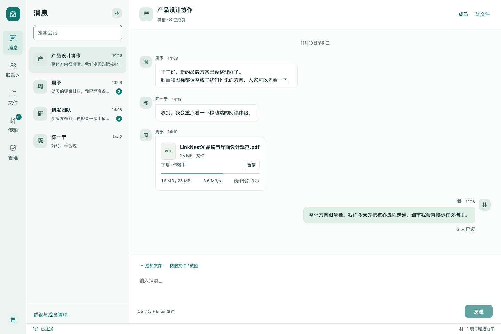
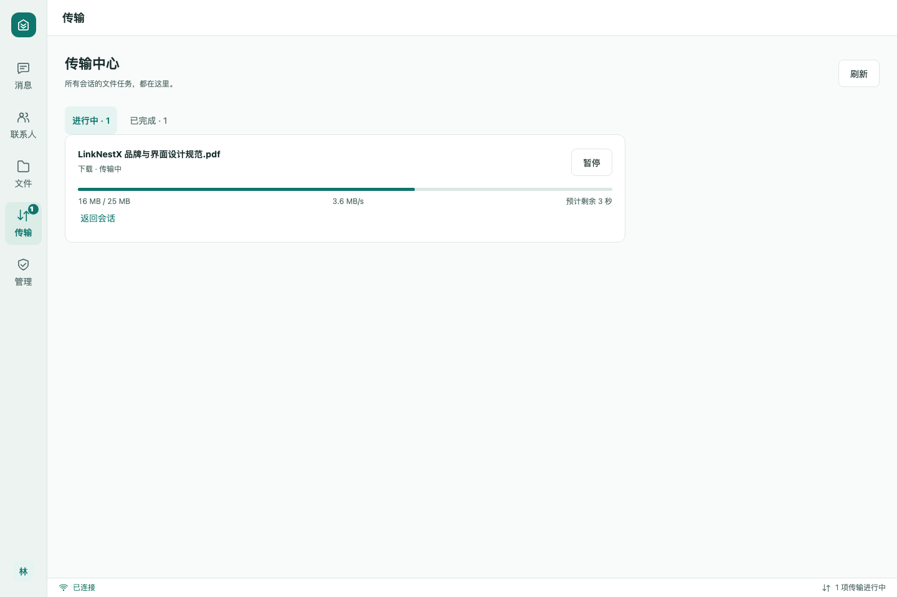
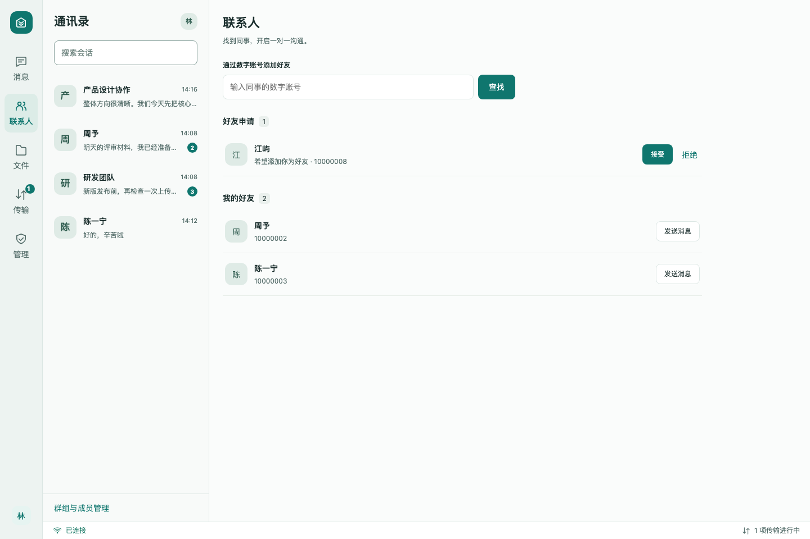
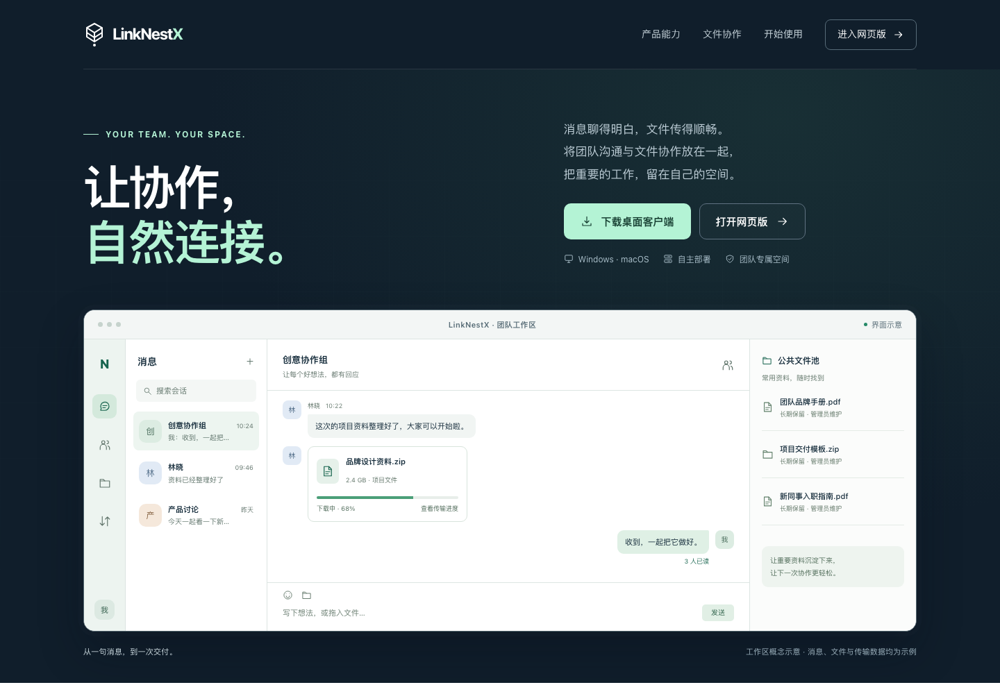
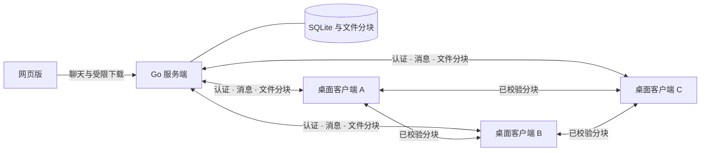

<div align="center">

# LinkNestX

### 让消息与文件，自然流动。

自托管的团队聊天与文件协作平台。把群聊、已读、大文件传输与团队文件池，放进同一个工作区。

**简体中文** · [English](README.en.md)


[](LICENSE)

[功能亮点](#features) · [界面预览](#preview) · [快速开始](#quick-start) · [部署文档](docs/deployment.md) · [路线图](#roadmap)

</div>

---

LinkNestX 面向希望自行管理协作数据的团队：消息和文件记录存储在自己的服务器上，桌面客户端负责大文件与后台任务，浏览器提供随手可用的轻量聊天入口。文件下载可同时使用服务器和其他获授权客户端的数据，已经校验的分块无需等整个文件下载完就能参与传输。

> **当前状态：0.2 开发预览。** 核心功能已通过本地测试与真实服务联调。macOS ARM64 已完成本地构建；Windows 0.2 打包和实机验收仍待完成。当前版本适合评估与参与开发，完整平台和部署验收进度见[验证范围](#verification)。

<a id="preview"></a>
## 界面预览

<p align="center">
  
</p>

<p align="center"><sub>真实界面组件，使用演示数据；展示聊天、消息内文件进度和已读回执。</sub></p>

<details>
<summary>查看传输中心与联系人</summary>





以上截图均使用演示数据，不代表真实用户、传输速度或生产环境。

</details>

<details>
<summary>查看官网设计</summary>



</details>

<a id="features"></a>
## 为什么选择 LinkNestX

| 能力 | 为团队带来的体验 |
| --- | --- |
| **聊天与已读在一起** | 群聊、好友私聊、数字账号与头像；私聊显示已读，群聊可查看已读人数及名单。 |
| **文件就在对话中** | 桌面端拖入文件、粘贴文件或截图后发送；文件卡片直接显示进度、速率和预计剩余时间。 |
| **多源并行下载** | 从服务器与获授权的客户端并行取得已校验分块，支持部分文件转发、断点恢复与服务器回退。 |
| **大文件持续传输** | 桌面单文件上限 20 GB；关闭窗口后继续在托盘运行，传输中心集中管理任务、用时和平均速率。 |
| **团队公共文件池** | 管理员可将已发送文件纳入公共池，供所有已登录员工查找下载并长期保留。 |
| **数据由自己管理** | Go 服务端保存聊天、文件与审计记录，管理员管理员工账号、成员权限和设备会话。 |
| **轻量 Web 入口** | 同一服务提供浏览器登录、聊天、好友与文件下载，无需安装即可处理轻量协作。 |
| **内置更新流程** | 后台准备经过签名校验的增量更新，传输时延后安装；支持全量回退和失败恢复。 |

### 桌面端与网页版

| 功能 | 桌面端（Windows / macOS） | 网页版 |
| --- | --- | --- |
| 群聊、好友私聊、已读回执 | ✓ | ✓ |
| 数字账号、联系人与资料查看 | ✓ | ✓ |
| 群文件与公共池下载 | 单文件最多 20 GB | 单文件最多 1 GB，单次下载 |
| 文件上传、拖放与粘贴 | ✓ | — |
| 多源传输、暂停与恢复 | ✓ | — |
| 关闭窗口后继续任务 | 系统托盘运行时支持 | — |
| 传输统计与应用内更新 | ✓ | — |
| 管理员写操作 | ✓ | — |

网页版限制由服务端执行。下载交给浏览器管理；完整文件协作使用桌面端。上表描述功能设计与实现范围，平台实机状态见下文。

<details>
<summary>账号、已读与数据保留规则</summary>

- 账号由管理员创建，不开放自助注册。员工拥有唯一数字账号，好友申请通过后开启私聊。
- 只有前台实际看到的消息才标记已读。群聊按当前有权访问消息的成员统计，不包含发送者。
- 普通文件自上传完成起保留 **30 天**，到期由系统删除；公共池文件**不过期**，由管理员管理和删除。
- 聊天与审计记录保留**两个日历年**，清理边界按 UTC 日期计算。
- 公共池面向已登录员工，不是匿名分享；群文件仍需对应群成员权限。
- 20 GB / 1 GB 分别为 20,000,000,000 / 1,000,000,000 字节。
- 关闭桌面窗口会留在托盘；从托盘退出才结束应用。退出登录、停用账号或撤销设备会影响后续授权。

</details>

## 文件如何流动



例如 A 已取得文件开头、B 已取得中间、C 已取得结尾，三个客户端可以交换已校验的部分，同时继续向服务器请求其他分块。服务器负责身份、访问权限、文件清单和节点协调；客户端只提供获授权的内容。实际可用来源取决于在线节点与网络条件，跨 NAT 场景可配置 STUN/TURN。

<a id="quick-start"></a>
## 快速开始

### 1. 准备环境

从本仓库获取源码后，准备 **Go 1.26+、Node.js 22+、npm 10+**。仅体验网页版不需要 Rust；桌面开发还需要 **Rust 1.90+** 和平台原生工具链，详见[开发指南](docs/development.md)。锁定依赖的已验证工具链版本也记录在该文档中。

### 2. 启动本机服务与网页版

在仓库根目录的 **Bash 终端**执行（Windows 使用 Git Bash）：

```bash
npm --prefix client ci
npm --prefix client run build

export LINKNESTX_WEB_ASSETS_DIR="$PWD/client/dist"
export LINKNESTX_BOOTSTRAP_ADMIN_USERNAME="admin"
read -r -s -p "设置首次管理员密码（至少 8 个字符）：" LINKNESTX_BOOTSTRAP_ADMIN_PASSWORD
printf '\n'
export LINKNESTX_BOOTSTRAP_ADMIN_PASSWORD

./scripts/dev-server.sh
```

打开 **[http://127.0.0.1:8080/app/](http://127.0.0.1:8080/app/)**，使用刚设置的账号登录。首页位于 `/`，客户端下载页位于 `/downloads`，健康检查位于 `/healthz`。下载页只列出管理员实际发布的安装包。

服务默认仅监听本机，数据写入 `server/data/`。首次初始化完成后，停止服务并执行以下命令，再正常启动；它不会重置已创建账号的密码：

```bash
unset LINKNESTX_BOOTSTRAP_ADMIN_USERNAME LINKNESTX_BOOTSTRAP_ADMIN_PASSWORD
./scripts/dev-server.sh
```

此流程用于本机评估。对团队开放前，配置独立的访问令牌与刷新令牌密钥、持久化存储和访问地址；公网使用 HTTPS。变量需注入进程环境，程序不会自动读取 `.env`。完整步骤见[部署说明](docs/deployment.md)。

### 3. 启动桌面开发环境

在 [deployment.rs](client/src-tauri/src/deployment.rs) 中将 `SERVER_ORIGIN` 设置为自己的服务器地址；本机开发可使用 `http://127.0.0.1:8080`。客户端地址在构建时固定，员工无需自行填写。

```bash
make dev-client
# 没有 Make 时：
npm --prefix client run desktop:dev
```

正式发布前，将该地址设为实际部署地址并重新构建。平台依赖、测试、签名和打包命令见[开发指南](docs/development.md)。

## 文档导航

| 文档 | 内容 |
| --- | --- |
| [开发指南](docs/development.md) | 环境、开发、测试、桌面打包与贡献方式 |
| [部署说明](docs/deployment.md) | 持久化、服务配置、HTTPS、STUN/TURN 与平台签名 |
| [HTTP API](api/openapi.yaml) | 服务端接口定义 |
| [传输协议](docs/transfer-contract.md) | 文件清单、分块与传输约定 |
| [更新格式](docs/update-format.md) | 离线签名、内容对象与发布流程 |
| [客户端更新](docs/update-client.md) | 安装位置、更新互斥、健康确认与回滚 |

<a id="verification"></a>
## 版本与验证范围

0.2 已完成本地 Go 测试、竞态检查和静态分析，前端 **152 项**测试与生产构建、原生 **131 项**常规测试，以及真实 Go 服务下的聊天、已读、浏览器下载和多源传输联调。真实传输使用 48 MiB 文件，两个客户端与服务器共同提供数据；另有签名更新包重构与完整性验证。

以下事项仍需要目标环境验收：

- **Windows 0.2** 打包、安装及实机运行；已有旧版产物不代表新版可用。
- macOS 安装包当前为本地 ad-hoc 签名，**没有 Developer ID 签名或公证**；系统拖放、剪贴板与完整已安装客户端升级尚需交互式验证。
- 真实跨 NAT / TURN 网络、实际 20 GB 完整传输，以及生产部署。20 GB 清单与 Web 1 GB 大小门槛测试不等于实际传输了对应大小。
- GitHub Actions 工作流已配置；实际状态应以远程运行结果为准。

**0.1 不含更新器，首次升级到 0.2 必须手动安装。** 后续版本才使用内置更新流程；增量复用量取决于实际文件变化，不保证固定节省比例。

<a id="roadmap"></a>
## 路线图

- [x] 群聊、好友私聊、数字账号与已读回执
- [x] 公共文件池、权限检查、保留期与审计记录
- [x] 多源分块传输、断点恢复与传输统计
- [x] 受限网页版与签名增量更新实现
- [ ] Windows 0.2 打包与 Windows/macOS 完整实机验收
- [ ] 公网与跨 NAT 场景验证
- [ ] 群公告
- [ ] 企业知识库
- [ ] 可配置双因素认证

## 项目结构

```text
LinkNestX/
├── server/           # Go API、认证、聊天、文件、SQLite 与更新发布
├── client/           # React + TypeScript 界面
│   └── src-tauri/    # Rust 原生传输、WebRTC、系统集成与更新器
├── api/              # OpenAPI 定义
├── scripts/          # 本地开发、检查与打包入口
└── docs/             # 架构、部署、协议与验证说明
```

## 参与项目

欢迎通过 Issues 描述使用场景、复现问题或提出功能建议，也欢迎提交范围清晰的 Pull Request。开始前请阅读[开发与贡献指南](docs/development.md#contributing)，为行为变更提供相应验证。请勿在问题报告或提交中包含员工数据、访问令牌、签名私钥或真实服务器凭据。

## 许可证

本项目采用 [GNU AGPL-3.0](LICENSE)。使用、修改和分发须遵守许可证；向用户通过网络提供修改版服务时，须按许可证要求向这些用户提供相应源代码。完整条款以 [LICENSE](LICENSE) 为准。
